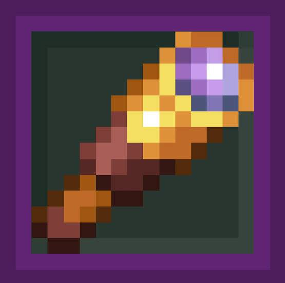

  

<h1 align="center">PXX-Spyglass</h1>

  Logging and rollback for Paper 26.1.2, 26.2 and 26.3. 
  See who changed what, search it in seconds, and roll back griefing without lagging the server.

> [!NOTE]
> **PXX-Spyglass** is an independent community fork of the original [Spyglass](https://github.com/medievalrp-net/Spyglass) plugin created by [MedievalRP](https://github.com/medievalrp-net). This project is not affiliated with or endorsed by the original authors.

  
  
  

  
  
  

**PXX-Spyglass** records blocks, containers, items, chat, commands, logins and combat, lets staff search all of it with short queries, and rolls back griefing off the main thread. It runs on ClickHouse (recommended), SQLite, MariaDB/MySQL or MongoDB.

This project is built upon the solid foundation of [Spyglass](https://github.com/medievalrp-net/Spyglass), incorporating custom improvements, fixes, and community features.

For usage, commands, and configuration reference, consult the **[PXX-Spyglass documentation](https://Paradoxx710.github.io/Spyglass/)**.

## Upstream Project & Credits

This project is based on [Spyglass](https://github.com/medievalrp-net/Spyglass), originally created and maintained by the MedievalRP team and contributors. All credit for the original architecture and design belongs to them.

## Modules

- `spyglass/`: the Paper plugin.
- `spyglass-api/`: the public API other plugins build against (based on `net.medievalrp:spyglass-api`).
- `spyglass-core/`: shared internals, like storage and codecs.
- `spyglass-velocity/`: an optional, read-only Velocity companion for cross-server search.
- `spyglass-importer/`: a command-line CoreProtect importer.

## License

The plugin (`spyglass`, `spyglass-core`, `spyglass-velocity`) is licensed under [GPL-3.0](LICENSE), in accordance with the original project. The API (`spyglass-api`) is [Apache-2.0](spyglass-api/LICENSE). See [licensing](.github/LICENSING.md) for details.

The CoreProtect importer is a clean-room implementation, written from paraphrased schema notes rather than CoreProtect's GPL source.
